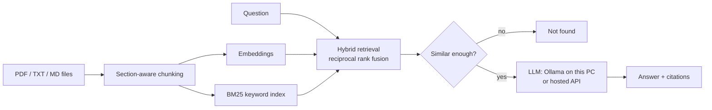

# Policy RAG

Question answering over health insurance policy documents using retrieval-augmented generation (RAG). You ask a question in plain English, the system finds the relevant policy clauses, and an LLM answers using only those clauses, with citations.

The LLM can run in two ways: locally on your own PC through Ollama (free, private, no API key), or through a hosted API if you have a key. Without either, the app still works and quotes the matching passage.

```
Q: I have diabetes from before buying the policy. When is it covered?

A: Pre-existing diseases are covered after 36 months of continuous cover
   (24 months under the Premier plan) [1].

Sources:
  [1] 03_waiting_periods_and_exclusions.md - Pre-existing diseases
```

## Why this project

Policy documents are long, and the answer to a simple question ("can I claim for cataract surgery yet?") is usually one clause buried in one section. An LLM on its own will guess. RAG makes it answer from the document, show where the answer came from, and say "not found" when the document does not cover the question.

## How it works



1. **Load** `.pdf`, `.txt` and `.md` files (`rag/loader.py`).
2. **Chunk** on markdown headings first, then into 120-word windows with a 30-word overlap, so one chunk never mixes two policy sections (`rag/chunker.py`).
3. **Embed** each chunk with `all-MiniLM-L6-v2` from sentence-transformers. If that package is not installed, a TF-IDF embedder is used instead, so the project still runs (`rag/embeddings.py`).
4. **Retrieve** with both dense similarity and BM25 keyword search, and merge the two rankings with reciprocal rank fusion (`rag/store.py`, `rag/bm25.py`).
5. **Guardrail**: if the best chunk is not similar enough to the question, the answer is "I couldn't find this in the policy documents" and the LLM is not called (`rag/pipeline.py`).
6. **Generate** the answer with an LLM that is told to use only the retrieved passages and cite them. The LLM is either a local model on Ollama or a hosted model behind an OpenAI-compatible API. Both get the same prompt. If neither is available, the best matching passage is quoted instead (`rag/generator.py`).

BM25 and the vector store are written from scratch in NumPy rather than through a framework. The corpus is small enough that an exact search is fast, and the retrieval logic stays readable.

## Quick start

Needs Python 3.10 or newer.

```bash
git clone https://github.com/<your-username>/policy-rag.git
cd policy-rag
python -m venv .venv
source .venv/bin/activate        # Windows: .venv\Scripts\activate
pip install -r requirements.txt

python cli.py ingest             # build the index from the sample documents
python cli.py ask "What is the grace period for paying the premium?"
streamlit run app.py             # chat UI in the browser
```

### Choosing the LLM

Copy `.env.example` to `.env` and set `LLM_PROVIDER` to `ollama`, `api` or `off`. You can also switch in the sidebar of the app, or per question with `--llm`.

**Option 1: Ollama on your own PC (default)**

Install [Ollama](https://ollama.com), then:

```bash
ollama pull deepseek-r1:1.5b
python cli.py ask "When can I claim for cataract surgery?" --llm ollama
```

Nothing leaves your machine. To use another model, set `OLLAMA_MODEL`, for example `OLLAMA_MODEL=llama3.2:3b`.

**Option 2: Hosted API**

Works with any provider that follows the OpenAI chat completions format (OpenAI, Groq, OpenRouter and others). In `.env`:

```
LLM_PROVIDER=api
LLM_API_BASE=https://api.openai.com/v1
LLM_API_MODEL=gpt-4o-mini
LLM_API_KEY=your-key-here
```

```bash
python cli.py ask "When can I claim for cataract surgery?" --llm api
```

The `.env` file is git-ignored, so the key is not pushed to GitHub. With this option the question and the retrieved passages are sent to the provider.

### Using your own documents

```bash
python cli.py ingest --docs path/to/your/folder
```

or upload files in the sidebar of the Streamlit app.

## Evaluation

`eval/questions.json` has 30 questions, each tagged with the document and the exact phrase the correct chunk must contain. The questions are paraphrased on purpose ("Will the policy pay for a root canal?" when the document says "dental treatment"), because real users do not use the wording of the policy.

```bash
python cli.py eval -v
```

Results with the **TF-IDF fallback embedder** (52 chunks, 30 questions):

| Mode   | hit@1 | hit@3 | hit@5 | MRR   |
|--------|-------|-------|-------|-------|
| bm25   | 0.53  | 0.70  | 0.83  | 0.634 |
| dense  | 0.43  | 0.67  | 0.73  | 0.571 |
| hybrid | 0.47  | 0.70  | 0.80  | 0.602 |

What this shows: with TF-IDF, the "dense" side is also word-based, so the hybrid has nothing new to add over BM25, and all three modes miss the same paraphrased questions (root canal, "change my mind", "papers"). Those are the cases semantic embeddings are meant to fix.

Results with **all-MiniLM-L6-v2** (run `python cli.py ingest --embedder minilm` then `python cli.py eval`):

| Mode   | hit@1 | hit@3 | hit@5 | MRR   |
|--------|-------|-------|-------|-------|
| bm25   |       |       |       |       |
| dense  |       |       |       |       |
| hybrid |       |       |       |       |

<!-- TODO: fill in after running the evaluation with MiniLM on your machine. -->

## Tests

```bash
pytest
```

23 tests cover chunking, BM25, index save/load, all three search modes, the not-found guardrail, the Ollama and API calls (against a local mock server) and the fallbacks when Ollama is down or the API key is missing. They use the TF-IDF embedder, so they need no model download and run in GitHub Actions on every push.

## Configuration

| Variable | Default | Meaning |
|---|---|---|
| `RAG_EMBEDDER` | `auto` | `minilm`, `tfidf`, or `auto` (MiniLM if installed) |
| `RAG_EMBED_MODEL` | `sentence-transformers/all-MiniLM-L6-v2` | any sentence-transformers model |
| `LLM_PROVIDER` | `ollama` | `ollama` (local PC), `api` (hosted) or `off` |
| `OLLAMA_HOST` | `http://localhost:11434` | Ollama server |
| `OLLAMA_MODEL` | `deepseek-r1:1.5b` | local model used to write answers |
| `LLM_API_BASE` | `https://api.openai.com/v1` | OpenAI-compatible endpoint |
| `LLM_API_MODEL` | `gpt-4o-mini` | hosted model used to write answers |
| `LLM_API_KEY` | empty | API key (falls back to `OPENAI_API_KEY`) |
| `RAG_CHUNK_WORDS` / `RAG_CHUNK_OVERLAP` | `120` / `30` | chunk size and overlap in words |
| `RAG_TOP_K` | `4` | chunks passed to the LLM |

## Project structure

```
policy-rag/
├── app.py                  Streamlit chat UI
├── .env.example            settings template (copy to .env)
├── cli.py                  ingest / ask / eval commands
├── rag/
│   ├── loader.py           read pdf, txt, md
│   ├── chunker.py          section-aware chunking
│   ├── embeddings.py       MiniLM and TF-IDF embedders
│   ├── bm25.py             BM25 from scratch
│   ├── store.py            index + dense / bm25 / hybrid search
│   ├── generator.py        prompt, Ollama call, API call, extractive fallback
│   └── pipeline.py         build_index and RAGPipeline.ask
├── eval/                   30-question retrieval benchmark
├── tests/                  pytest suite
└── data/sample_policies/   six sample policy documents
```

## Limitations and next steps

- The sample documents are small. The NumPy store does an exact search, which is fine for thousands of chunks but would need FAISS or a vector database beyond that.
- The evaluation measures retrieval only. Answer quality (faithfulness to the retrieved text) is not scored yet.
- The not-found threshold is a fixed similarity cut-off per embedder. It should be tuned on a set of out-of-scope questions.
- PDF tables and scanned PDFs are not handled; text is extracted page by page with pypdf.
- A cross-encoder re-ranker after retrieval would be the next thing to try for the questions still missed.

## About the sample data

"Nimbus Health Cover" and "Nimbus General Insurance" are made up. The six documents in `data/sample_policies` were written for this project so it has something to search. They are not a real policy and should not be used for insurance decisions.

## License

MIT
